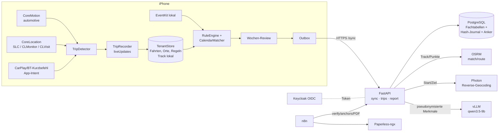
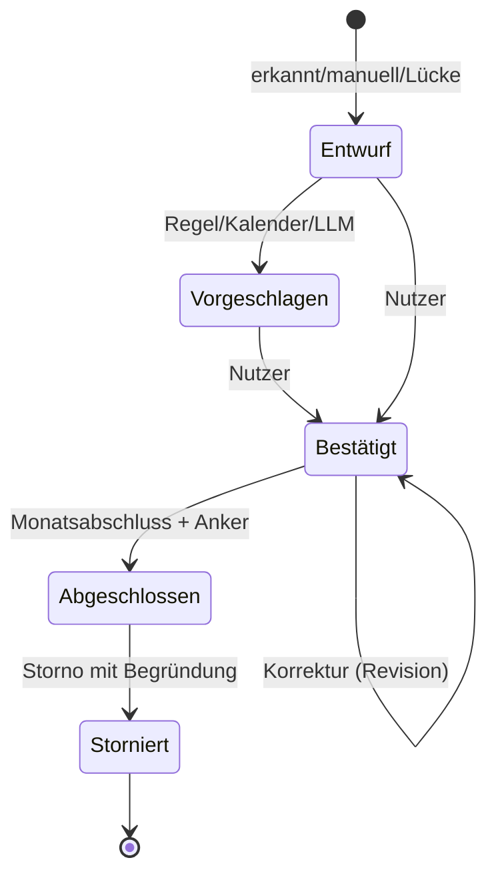

# Konzept „Intelligentes Fahrtenbuch“ – Erweiterung Fahrzeugbuch

Stand: 25.11.2026 · Status: **Entwurf zur Entscheidung** (nichts implementiert)
Legende: **[Q n]** Quelle (Liste am Ende) · **[A]** Annahme · **[P]** vor Umsetzung prüfen (Steuerverwaltung/Treuhand)

> Keine Steuer- oder Rechtsberatung. Sätze und Grenzwerte ändern jährlich und je Kanton; der Kanton des Nutzers ist nicht bekannt. Alle Beträge sind deshalb als **Parameter je Jahr/Kanton** vorgesehen, nicht fest im Code.

---

## 1. Ziel, Nutzen, Abgrenzung

**Ziel:** Das bestehende Fahrzeugbuch (Tanken, km-Stände, Wartung, revisionssicheres Journal) wird zu einem Fahrtenbuch erweitert, das Fahrten **weitgehend automatisch** erfasst, **Zweck und Kategorie vorschlägt** (privat / geschäftlich / Arbeitsweg) und nach einer kurzen menschlichen Bestätigung **steuer- und spesentaugliche Berichte** liefert. Dabei bleiben die Grundsätze des Bestehenden erhalten: local-first, selbst gehostet, Mandantentrennung (privat / b-re.ch), unveränderliches Hash-Ketten-Journal. Nutzen: Das Fahrtenbuch ist die Voraussetzung für die **effektive Methode** beim Privatanteil (statt Pauschale 0.9 %/Monat), für steuerfreie **Kilometerentschädigungen** und für den belegten **Fahrkostenabzug**. Der Erfassungsaufwand sinkt von „jede Fahrt tippen“ auf „einmal pro Woche 5 Vorschläge bestätigen“.

**Abgrenzung (nicht Teil des Konzepts):**
- Kein Flotten-/Echtzeit-Tracking, keine Live-Ortung, keine Fahrverhaltensbewertung (Tempo, Bremsen).
- Keine OBD-/Telematik-Hardware und keine Hersteller-Cloud-APIs im MVP (später optional für den Odometer).
- Keine Buchhaltung, Lohnbuchhaltung oder MWST-Abrechnung; es werden nur **Grundlagen/Exporte** erzeugt.
- Keine zertifizierte GeBüV-Lösung (gleiche Grenze wie heute, siehe README „Revisionssicherheit“).
- Kein Android/Web-Client.

## 2. Anwendungsfälle / User Stories

| # | Rolle | Story | Ergebnis |
|---|---|---|---|
| US1 | Privat | Als Fahrer möchte ich, dass Fahrten mit dem Privatauto ohne Zutun erkannt werden, damit ich km und Verbrauch je Zweck sehe. | Fahrten mit Start/Ziel/Distanz, Standard „privat“ |
| US2 | Geschäftlich b-re.ch | Als Inhaber möchte ich beim Geschäftsfahrzeug jede Fahrt als geschäftlich/privat kennzeichnen, damit ich die effektive Methode statt der 0.9 %-Pauschale belegen kann. | Lückenloses Fahrtenbuch mit km-Kette, Jahresauswertung Privatanteil |
| US3 | Arbeitsweg | Als Pendler möchte ich, dass wiederkehrende Fahrten Wohnort ↔ Arbeitsort automatisch als Arbeitsweg erkannt werden. | Regel-Vorschlag „Mo–Fr Wohnort→Büro = Arbeitsweg“ |
| US4 | Spesen | Als Mitarbeitender/Inhaber möchte ich geschäftliche Fahrten mit dem **Privatauto** monatlich als Spesenabrechnung (km × Ansatz) an b-re.ch geben. | PDF + CSV Spesenbeleg, Ablage in Paperless-ngx |
| US5 | Steuererklärung | Als Steuerpflichtiger möchte ich am Jahresende Arbeitsweg-km, Arbeitstage und Abzug (Bund/Kanton, mit Obergrenze) auf einen Blick. | Jahresbericht „Steuern“ |
| US6 | Treuhand (Leserolle) | Als Treuhänder möchte ich das abgeschlossene Fahrtenbuch prüfen, ohne private Ziele zu sehen. | Lesezugriff, private Fahrten nur als km |
| US7 | Prüfung | Als Steuerpflichtiger möchte ich bei einer Rückfrage nachweisen, dass Einträge nicht nachträglich geschönt wurden. | Journal, signierte Anker, Monatsabschluss im PDF |
| US8 | Mitarbeitende (später) | Als Arbeitgeber möchte ich Geschäftsfahrzeuge von Mitarbeitenden abrechnen, ohne sie zu überwachen. | Privatmodus, keine Ortsdaten privater Fahrten |

## 3. Rechtliche Anforderungen Schweiz

### 3.1 Steuerliche Eckwerte (Stand 2026)

| Thema | Regel | Quelle | Bedeutung für die App |
|---|---|---|---|
| Privatanteil Geschäftsfahrzeug – Pauschale | 0.9 % des Kaufpreises (exkl. MWST) **pro Monat**, mind. CHF 150/Monat; seit 1.1.2022 deckt die Pauschale auch den **Arbeitsweg** (Art. 5a BKV); Deklaration Lohnausweis Ziff. 2.2, Feld F angekreuzt | [Q1] [Q2] [Q3] | Vergleichsrechnung Pauschale ↔ effektiv; Kaufpreis als Fahrzeugfeld |
| Privatanteil – effektive Methode | Alternativ zulässig; setzt ein **vollständiges Fahrtenbuch** voraus; lohnt sich bei wenig Privatfahrten und kurzem Arbeitsweg; wird von der ESTV kritisch geprüft | [Q1] [Q2] [Q4] | Kernnutzen des Fahrtenbuchs → Lückenlosigkeit ist Muss |
| Pauschale nur bei überwiegend geschäftlicher Nutzung | Mehrere Fachquellen: Pauschale nur bei > 50 % geschäftlicher Nutzung, sonst effektiv | [Q5] [Q6] **[P]** | Kennzahl „Anteil geschäftlich“ im Jahresbericht, Warnung < 50 % |
| Einheitliche Methode | Fachquelle: für alle Personenwagen des Unternehmens dieselbe Methode | [Q6] **[P]** | Methode als Mandanten-Einstellung, nicht je Fahrzeug |
| Arbeitsweg mit Privatauto | Abzug **CHF 0.75/km** ab 1.1.2026 (bisher 0.70; künftig am TCS-Kilometerpreis orientiert) | [Q7] [Q8] [Q9] | Parameter `km_rate` je Jahr |
| Fahrkostenabzug – Maximum Bund | **CHF 3'300** (2025 erhöht, 2026 unverändert) | [Q10] [Q11] | Parameter `cap_federal` je Jahr |
| Fahrkostenabzug – Kantone | stark unterschiedlich, z. B. TG CHF 6'000, SG CHF 8'000 (ab 2025) | [Q11] [Q12] | Parameter `cap_canton`; Kanton = offene Frage |
| Kilometerentschädigung Geschäftsfahrten mit Privatauto | Referenzansatz 0.75 CHF/km (2026), steuerfrei bei belegten Dienstfahrten; arbeitsrechtlich nicht zwingend, Spesenreglement massgebend | [Q9] [Q13] | Ansatz aus Spesenreglement b-re.ch, Default 0.75 |
| Arbeitsweg im Geschäftsfahrzeug „entgeltlich“ | gilt als entgeltlich, wenn mind. 0.75 CHF/km bezahlt werden | [Q8] | Option „Arbeitsweg wird bezahlt“ |
| Aussendienst | Aussendiensttage (direkt von zu Hause zum Kunden) reduzieren den Arbeitsweg; Aussendienstanteil im Lohnausweis (frühere Praxis Ziff. 15) | [Q14] **[P]** | Kategorie „Aussendienst“, Zählung Aussendiensttage |
| MWST Privatanteil | Pauschal 0.9 %/Monat des Kaufpreises exkl. MWST = Betrag **inkl.** 8.1 % MWST; effektive Methode mit Fahrtenbuch möglich; Arbeitsweg zählt MWST-lich zur geschäftlichen Nutzung | [Q5] [Q6] | Export „MWST-Grundlage“ (nur wenn b-re.ch MWST-pflichtig **[A]**) |
| MWST Autokilometeransatz | ESTV-Praxisänderung MWST-Info 08 ab 1.1.2026 (Anpassung an BKV-Anhang, 0.70 → 0.75) | [Q15] **[P]** | Ansatz parametrisiert |

**Ungeklärt [P]:** Bei der effektiven Methode und Geschäftsfahrzeug: Wird der Arbeitsweg als Einkommen aufgerechnet und darf dann der Fahrkostenabzug (mit Obergrenze) geltend gemacht werden? Die Quellen sind dazu uneinheitlich (Bern-FAQ vs. Fachbeiträge, [Q1] [Q16]). → Mit Treuhand/kantonaler Steuerverwaltung klären; die App rechnet beide Varianten.

### 3.2 Aufbewahrung und Nachweisbarkeit

| Anforderung | Quelle | Umsetzung |
|---|---|---|
| Geschäftsbücher und Buchungsbelege **10 Jahre** ab Ende Geschäftsjahr (Art. 958f OR) | [Q17] [Q18] | Fahrten/Berichte des Mandanten b-re.ch ≥ 10 Jahre; Löschsperre |
| Elektronisch zulässig, wenn Übereinstimmung mit Geschäftsvorfällen und jederzeitige Lesbarkeit gewährleistet | [Q18] | PDF/A-Export + CSV/JSON je Jahr nach Paperless-ngx |
| **Integrität:** Änderungen müssen feststellbar sein (Art. 3 GeBüV) | [Q19] [Q20] | Bestehendes Hash-Ketten-Journal + signierte Anker; Monatsabschluss |
| Regelmässige Prüfung, protokollierte Migration (Art. 10 GeBüV); Zugriffsschutz/-protokoll (Art. 8) | [Q19] [Q21] | `/audit/verify` periodisch (n8n), Migrationen als Revision |
| Zeitnahe, chronologische, geschlossene Erfassung (Praxis Fahrtenbuch) | [Q22] **[A]** (Praxis DE, für CH plausibel) | Geräte- und Serverzeit im Journal, Frist „Bestätigung ≤ 7 Tage“ sichtbar |

Hinweis: Es gibt am Markt digitale Fahrtenbücher, die nach Herstellerangabe von der Schweizerischen Steuerkonferenz geprüft wurden (autoSense, [Q23]); ein öffentliches Prüfraster der SSK wurde nicht gefunden → **[P]**.

#### Lösch- und Aufbewahrungskonzept (Stand Server, Review X15)

| Daten | Aufbewahrung | Löschung |
|---|---|---|
| Journal (`revisions`, `anchors`), Fachdaten, Belegdateien | mind. 10 Jahre ab Ende des Geschäftsjahres (Art. 958f OR) | keine technische Löschung: App-Rolle ohne `DELETE`, Trigger sperren das Journal; Stornos bleiben sichtbar. Nach Ablauf der Frist nur durch den Betreiber (Owner) und nur mandantenweise: vorher PDF/CSV je Jahr und die signierten Anker (`/audit/anchors`) archivieren – eine Teil-Löschung einzelner Jahre bräche die Hash-Kette. Bewusst nicht automatisiert. |
| GPS-Rohdaten / Tracks | Gerät: 30 Tage nach Bestätigung (Endpunkte 90 Tage) | Server speichert keine Tracks (nur `track_hash`); Map-Matching verwirft sie nach der Anfrage |
| Zugriffs- und Sicherheitslogs | empfohlen höchstens 90 Tage | Rotation beim Betreiber: Caddy `roll_size`/`roll_keep`, Docker `json-file` `max-size`/`max-file` bzw. journald `MaxRetentionSec=90day`. Logs enthalten keine Query-Strings (Koordinaten), keine SQL-Parameter, keine Tokens; Reverse-Geocoding nur per POST (Koordinaten nie in der URL) |
| Valkey (Rate-Limits, Sperren, Metriken) | flüchtig, jeder Schlüssel mit TTL | ohne Persistenz; Neustart löscht alles |
| Belegfotos der Bildauswertung (`/scan`) | nicht gespeichert | Metadaten (Exif/GPS) entfernt der Server vor der Weitergabe an das selbst gehostete Vision-LLM |
| Backups (DB, Belege) | Frist wie Journal, Rotation beim Betreiber | abgelaufene Sicherungen löschen; `ANCHOR_SIGNING_KEY` getrennt aufbewahren |

### 3.3 Abgeleitete Muss-Felder je Fahrt

Das Schweizer Recht schreibt kein Feldraster vor. Die folgenden Felder sind aus der Praxis (effektive Methode, Spesen, Fahrkostenabzug) abgeleitet **[A]** und mit Treuhand zu bestätigen **[P]**.

| Feld | geschäftlich | privat | Arbeitsweg | Herkunft |
|---|---|---|---|---|
| Fahrzeug, Fahrer (`sub`/Name) | Muss | Muss | Muss | Konto/Fahrzeugwahl |
| Datum, Startzeit, Endzeit | Muss | Muss | Muss | automatisch |
| km-Stand Beginn / Ende | Muss | Muss | Muss | km-Kette + Odometer-Anker |
| Distanz (km) | Muss | Muss | Muss | Differenz km-Stand; GPS/OSRM als Kontrolle |
| Start- und Zielort (Adresse) | Muss | **nur Gemeinde/leer** (Privatmodus) | Muss (fix: Wohnort/Arbeitsort) | Reverse-Geocoding, Ortsliste |
| Zweck / Kunde / Projekt | Muss | – | – | Vorschlag + Bestätigung |
| Kategorie | Muss | Muss | Muss | Vorschlag + Bestätigung |
| Umweg/Zwischenhalt (bei gemischten Fahrten) | Muss, wenn vorhanden | – | – | Fahrt aufteilen |
| Bestätigt durch, Zeitpunkt | Muss | Muss | Muss | Journal |
| Quelle (auto/manuell/Lücke) | Muss | Muss | Muss | System |
| Belegbezug (Spesen, Parkticket) | Kann | – | – | Paperless-ID |

## 4. Funktionsumfang „intelligent“

| Funktion | Beschreibung | Mensch entscheidet? |
|---|---|---|
| **Automatische Erfassung** | Fahrtbeginn über CoreMotion „automotive“ + Ortsänderung, optional CarPlay/Bluetooth-Trigger; Fahrtende nach Stillstand > n min bzw. CLVisit. Aufzeichnung nur während Fahrt. | Nein (Entwurf) |
| **Manuell/Start-Stopp** | Fallback-Knopf, Live Activity, App-Intent „Fahrt starten/beenden“ (Siri, Kurzbefehl). | – |
| **Orte lernen** | Häufige Start-/Zielpunkte werden zu Orten gruppiert („Büro“, „Kunde X“, „Wohnort“); Radius je Ort; Nutzer benennt einmal. | Ja (Benennung) |
| **Zweck-Vorschläge** | Stufen: (1) feste Regeln (Ort/Zeit/Wochentag) → (2) Kalender auf dem Gerät (Termin mit Ort ± 2 h) → (3) Wiederholungsmuster → (4) LLM-Vorschlag für den Rest. Jeder Vorschlag mit Begründung und Konfidenz. | **Ja, immer** |
| **Wiederholungserkennung** | Gleiche Ort-Paare zu ähnlichen Zeiten ≥ 3× in 4 Wochen → Vorschlag einer Regel. | Ja |
| **Lückenerkennung** | (a) km-Ende Fahrt n ≠ km-Beginn Fahrt n+1, (b) Summe Fahrten-km ≠ Differenz Odometer-/Tank-km (Toleranz z. B. 2 % bzw. 5 km), (c) Fahrt endet an Ort A, nächste beginnt an Ort B. → Lückenfahrt „unbekannt“ zum Klassifizieren. | Ja |
| **Plausibilisierung** | GPS-Distanz vs. OSRM-Route vs. km-Stand; Tankvorgang mit km zwischen zwei Fahrten; Verbrauch je Fahrt-km; Geschwindigkeit/Dauer unplausibel. | Warnung |
| **Berichte** | Monat/Jahr: km nach Kategorie, Fahrtenbuch-PDF, Privatanteil pauschal vs. effektiv, Kilometerentschädigung, Arbeitsweg-Abzug (Bund/Kanton mit Obergrenzen), Aussendiensttage. | – |
| **Freigabe-Workflow** | Entwurf → vorgeschlagen → bestätigt → Monat abgeschlossen (forcierter signierter Anker) → nur noch Storno + Korrektur mit Begründung. Optional Freigabe durch zweite Person (Arbeitgeber/Treuhand) bei Spesen. | Ja |

Rechenbeispiele (Parameter, **[A]**):
- Effektiver Privatanteil = Fahrzeugkosten Jahr × (privat-km ÷ total-km). Kosten aus Tank/Wartung (vorhanden) + neu: Abschreibung, Versicherung, Steuer, Leasing.
- Kilometerentschädigung = geschäftliche km (Privatauto) × Ansatz Spesenreglement.
- Arbeitsweg-Abzug = min(Arbeitsweg-km × 0.75, Obergrenze Bund bzw. Kanton).

## 5. Datenschutz & Sicherheit

**Rechtsrahmen:** revDSG (in Kraft seit 1.9.2023): Rechtmässigkeit, Treu und Glauben, **Verhältnismässigkeit/Datensparsamkeit**, Zweckbindung, Speicherbegrenzung (Art. 6) und **Datenschutz durch Technik und datenschutzfreundliche Voreinstellungen** (Art. 7) [Q24] [Q25] [Q26]. Standortverläufe sind Personendaten mit hohem Profilbildungspotenzial **[A]**. Fahren Mitarbeitende: Art. 26 ArGV 3 verbietet Systeme zur Verhaltensüberwachung; GPS-Ortung eines Geschäftsfahrzeugs kann im überwiegenden Betriebsinteresse liegen, muss transparent sein und bei erlaubter Privatnutzung **abschaltbar**; keine permanente Echtzeitüberwachung [Q27] [Q28] [Q29].

| Prinzip | Massnahme |
|---|---|
| Datensparsamkeit | Aufzeichnung nur während erkannter Fahrt; keine Ortung im Stillstand. **Privatmodus:** private Fahrten speichern nur km, Zeit und optional Gemeinde – keine Adressen, kein Track. |
| On-Device zuerst | Fahrterkennung, Ortsclustering, Kalenderabgleich laufen auf dem iPhone. Kalenderinhalte verlassen das Gerät nicht (nur Merkmal „Termin mit Kunde X passt“). |
| GPS-Rohdaten | Nur lokal, verschlüsselt (Dateischutz `complete`), Löschung **30 Tage nach Bestätigung** (Default). Server erhält Start/Ziel (auf ~50 m gerundet) und Distanz; Track nur optional für Map-Matching, danach serverseitig verworfen. |
| Journal ≠ Rohdaten | Ins Journal kommen nur Fahrtdaten (Felder aus 3.3) + **SHA-256 des Tracks**. So bleibt die Fahrt nachweisbar, der Track ist löschbar (sonst Widerspruch unveränderliches Journal ↔ Speicherbegrenzung). |
| Externe Dienste | Kein Google/Apple-Geocoding per Default; OSRM, Photon, vLLM selbst gehostet im LAN. LLM erhält **pseudonymisierte** Merkmale (Ortsbezeichnung, Wochentag, Uhrzeit, Distanz), keine Koordinaten, keine Namen von Privatpersonen. |
| Verschlüsselung | Transport TLS (wie heute über Caddy/OPNsense); Postgres-Volume verschlüsselt (Proxmox/ZFS **[A]**); Backups verschlüsselt; Keychain/Datenschutzklassen wie bestehend. |
| Mandantentrennung | Fahrt gehört zum Mandanten des **Fahrzeugs**. Geschäftsfahrt mit Privatauto bleibt im Mandanten „privat“; an b-re.ch geht nur der **Spesenbeleg** (PDF/CSV via n8n → Paperless). Keine mandantenübergreifenden Referenzen. |
| Rollen | Leserolle (Treuhand) sieht private Fahrten nur aggregiert. Neue Rolle „Fahrer“ (später): eigene Fahrten erfassen, fremde nicht sehen. |
| Revisionssicherheit | Neue Entitäten laufen durch `/sync` → `append_revision`; `verify_state` deckt sie automatisch ab (generisch über `ENTITIES`). Monatsabschluss erzwingt `maybe_anchor(force=True)`; Anker täglich nach Paperless (bereits vorgesehen). |
| Transparenz | Info-Screen „Was wird gespeichert, wie lange, wer sieht es“; bei Mitarbeitenden schriftliches Reglement **[P]**. |

## 6. Architektur

### 6.1 Datenmodell (neue Entitäten, alle `Synced` + Journal)

| Entität | Wichtige Felder | Bemerkung |
|---|---|---|
| `trip` | `vehicle_id`, `driver_sub`, `start_at`, `end_at`, `km_start`, `km_end`, `distance_gps`, `distance_route`, `start_place_id`, `end_place_id`, `start_label`, `end_label`, `category` (business/private/commute/field), `purpose`, `customer_id`, `status` (draft/suggested/confirmed/locked), `source` (auto/manual/gap/import), `suggestion` (JSON: Kategorie, Zweck, Konfidenz, Begründung, Stufe), `track_hash`, `split_of`, `note` | Stornieren statt löschen; Aufteilen = Storno + 2 neue Fahrten mit `split_of` |
| `place` | `name`, `kind` (home/work/customer/other), `lat`, `lon` (gerundet), `radius_m`, `customer_id`, `default_category`, `private` | Wohnort-Koordinaten nur lokal **[A]**, Server nur Label |
| `customer` | `name`, `ref` (Kunden-/Projektnummer) | nur Mandant b-re.ch |
| `purpose_rule` | `priority`, Bedingungen (`from_place`, `to_place`, Wochentage, Zeitfenster, Fahrzeug), Ergebnis (`category`, `purpose`, `customer_id`), `auto_confirm` (Default **aus**), `origin` (user/learned) | Regeln sind versioniert → nachvollziehbar, warum vorgeschlagen |
| `trip_period` | `vehicle_id`, `month`, `status` (open/closed), `closed_by`, `anchor_seq`, `km_start`, `km_end` | Monatsabschluss |
| `tax_param` | `year`, `scope` (federal/canton:XX/tenant), `key` (`km_rate`, `cap_federal`, `cap_canton`, `private_share_pct`, `min_private_month`, `vat_rate`), `value`, `source_url` | nicht hart codiert |
| `vehicle` (erweitert) | `purchase_price_excl_vat`, `ownership` (business/private), `private_use_method` (flat/effective), Fixkosten | bestehende Entität |

Sync: identisch zum bestehenden Protokoll (Client-UUID, `op_id`, `base_version`, Konflikt = letzte Änderung gewinnt, Verlauf bleibt). Neu: Server lehnt Ops auf `locked`-Fahrten ab (`rejected: Monat abgeschlossen`).

### 6.2 Komponenten

**iOS (neu):**
- `TripDetector`: `CMMotionActivityManager` (automotive + Konfidenz; Achtung: bei Rotlicht gleichzeitig automotive+stationary [Q30], Konfidenz teils tief [Q31]), Significant-Location-Change und `CLMonitor`-Regionen um bekannte Orte als **Weck-Trigger** (Neustart der App nach Beenden nur über Region/SLC, Verhalten iOS-versionsabhängig [Q32] [Q33]), `CLVisit` für Fahrtende.
- `TripRecorder`: `CLLocationUpdate.liveUpdates(.automotiveNavigation)` + `CLBackgroundActivitySession` nur während der Fahrt (Session nur im Vordergrund startbar, sonst nur wiederaufnehmbar [Q34] [Q35]); Filter nach Genauigkeit; Douglas-Peucker-Reduktion.
- `CarTrigger`: App-Intents „Fahrt starten/beenden“; Kurzbefehl-Automation „CarPlay verbunden/getrennt“ (läuft ohne Rückfrage) bzw. „Bluetooth verbunden“ (teils Rückfrage) – vom Nutzer einzurichten [Q36] [Q37].
- `PlaceLearner`, `CalendarMatcher` (EventKit, lokal), `RuleEngine` (gleiche Regeln wie Server, damit offline Vorschläge entstehen).
- `TripStore` als Erweiterung von `TenantStore` (Outbox-Entitäten `trip`, `place`, `purpose_rule`), Review-UI, Berichte.
- Hintergrund-Modus `location`, Berechtigung „Immer“ + „Bewegung & Fitness“; Akku: GPS nur in Fahrt, sonst Motion/SLC (geringer Verbrauch [Q38]).

**Server (neu, FastAPI):**
- `geo.py`: OSRM `/match` (Track → Strassendistanz; Zeitstempel aufsteigend, `radiuses` ≈ 3× GPS-Genauigkeit, Sprünge > 60 s splitten [Q39] [Q40]) und `/route` (Plausibilität Start→Ziel); Photon Reverse-Geocoding mit CH-Extrakt (leichter als Nominatim, wöchentliche Länderextrakte [Q41] [Q42]). OSRM-Daten: CH + Grenzregionen **[A]**.
- `classify.py`: Aufruf vLLM (OpenAI-kompatibel) mit **Structured Outputs/JSON-Schema** (`category`, `purpose`, `customer_id`, `confidence`, `reason`); Qwen3.5-9B wird von vLLM unterstützt, Constrained Decoding erhöht JSON-Treue deutlich [Q43] [Q44]. Timeout 10 s, Fallback = kein Vorschlag. Nur Fahrten ohne Regel-/Kalendertreffer.
- `trips.py`: km-Kette, Lückenerkennung, Abgleich mit `odometer`/`fuel`, Monatsabschluss.
- `report.py` (erweitert): Fahrtenbuch-PDF, Jahresbericht, Spesenbeleg; CSV/JSON-Export.
- n8n: Webhook „Monat abgeschlossen“ → PDF + CSV nach Paperless-ngx (Tags: Mandant, Fahrzeug, Monat); täglich `/audit/verify` + Anker-Archiv; optional Paperless-ai zum Zuordnen von Park-/Mautbelegen zu Fahrten.

### 6.3 Übersicht





## 7. UX-Skizze

**Navigation:** Neuer Tab „Fahrten“ je Fahrzeug; Übersicht erhält Karte „5 Fahrten bestätigen“.

```
┌ Fahrten · Škoda Octavia ─────────── ⋯ ┐   ┌ Wochen-Review (3/5) ───────────────┐
│ ⚠ 5 zu bestätigen   ⚠ 1 Lücke 12 km  │   │ Di 24.11. 07:42–08:05 · 18.4 km    │
│ ─ Heute ───────────────────────────── │   │ Wohnort → Büro b-re.ch             │
│ 🟦 07:42 Wohnort → Büro      18 km  ✓ │   │ [ Karte, Track grob ]              │
│ 🟧 12:10 Büro → Kunde Meier  31 km  ? │   │ Vorschlag: ARBEITSWEG              │
│    Vorschlag: Geschäftlich · Termin   │   │ Grund: Regel „Mo–Fr Wohnort→Büro“  │
│    „Meier Offerte“ (Kalender)         │   │                                    │
│ ⬜ 18:30 Privat              22 km  ✓ │   │ [Privat] [Geschäftl.] [Arbeitsweg] │
│ ─ Gestern ─────────────────────────── │   │ Zweck: ____________ Kunde: ▾       │
│ ...                                   │   │ [Aufteilen] [Überspringen] [✓ OK]  │
│ [＋ Fahrt]  [▶ Start]                 │   └────────────────────────────────────┘
└───────────────────────────────────────┘
```

Interaktionen:
- **Wochen-Review** (Push-Mitteilung So 18:00 **[A]**): Karte für Karte, Wischen rechts = Vorschlag übernehmen, links = privat; „Alle 4 Arbeitswege bestätigen“ als Sammelaktion; Ziel < 1 min/Woche.
- **Lücke schliessen:** „Zwischen Mi 18:30 (km 53'410) und Do 07:40 (km 53'422) fehlen 12 km“ → [Privat] [Geschäftlich…] [Odometer korrigieren].
- **Ort benennen:** nach 3. Besuch eines unbekannten Orts: „Hier warst du 3×: Name? Kunde?“.
- **Regel vorschlagen:** „Jeden Mo–Fr Wohnort → Büro. Immer als Arbeitsweg vorschlagen?“ (nie automatisch bestätigen ohne explizite Zustimmung).
- **Monatsabschluss:** Checkliste (alle bestätigt, keine Lücke, km-Abgleich mit Tankdaten OK) → [Abschliessen] → PDF + Anker.
- **Jahresbericht:** Kacheln „Geschäftlich 62 % · Privat 21 % · Arbeitsweg 17 %“, Vergleich „Pauschale CHF 4'860 vs. effektiv CHF 2'940“, Arbeitsweg-Abzug Bund/Kanton.
- **Privatmodus-Schalter** in der Fahrtenzeile und als Kontrollzentrum-/Kurzbefehl („nächste Fahrt privat, ohne Orte“).

## 8. Umsetzungsplan

| Phase | Inhalt | Aufwand | Ergebnis |
|---|---|---|---|
| 0 | Abklärung Treuhand/Steuerverwaltung (Kanton, Methode, Muss-Felder, Arbeitsweg bei effektiver Methode), Entscheidungen Kap. 9 | S | Parameter + Feldliste verbindlich |
| 1 **MVP** | Entitäten `trip`, `place`, `customer`, `tax_param`; manuelle Fahrt + Start/Stopp-Knopf mit GPS-Aufzeichnung; km-Kette inkl. Odometer-/Tank-Abgleich und Lückenanzeige; Kategorien/Zweck; Fahrtenbuch-PDF Monat; Journal-Einbindung | M | Steuertaugliches Fahrtenbuch, noch ohne Automatik |
| 2 | Automatische Erkennung (Motion, SLC/CLMonitor, CLVisit, liveUpdates), Kurzbefehl/App-Intents CarPlay; Akku-/Zuverlässigkeitstest 4 Wochen | L | Fahrten erscheinen von selbst |
| 3 | OSRM-Match/Route, Photon (neuer Container), Plausibilisierung | M | Saubere Distanzen/Adressen |
| 4 | Regeln, Orte lernen, Kalender, Wiederholungserkennung; Wochen-Review | M | Vorschläge ohne LLM |
| 5 | LLM-Vorschläge via vLLM (Structured Outputs), Evaluierung auf 200 eigenen Fahrten | S–M | Restliche Fahrten mit Vorschlag |
| 6 | Monatsabschluss, Jahresbericht (Privatanteil, Kilometerentschädigung, Abzug), Spesenbeleg, n8n → Paperless | M | Berichte/Exporte |
| 7 (optional) | Mehrere Fahrer, Rolle „Fahrer“, Reglement, Freigabe durch Arbeitgeber | M | Mitarbeitendenfähig |

**Risiken**

| Risiko | Wirkung | Gegenmassnahme |
|---|---|---|
| iOS beendet/weckt App unzuverlässig (Force-Quit, iOS-Versionen, Stromsparmodus) | verpasste Fahrten | Lückenerkennung über km-Kette ist das Sicherheitsnetz; CarPlay-Kurzbefehl; Start/Stopp-Knopf |
| Motion-Fehlklassifikation (Bus/Zug als „automotive“) | Falsche Fahrten | Mitfahrer-/ÖV-Erkennung via bekannte Fahrzeuge/CarPlay; „Keine Fahrt mit meinem Auto“-Aktion |
| GPS-km ≠ Tacho | Abweichung im Fahrtenbuch | Odometer als massgebend, GPS nur Kontrolle; Kalibrierfaktor je Fahrzeug aus Tank-km |
| Steuerliche Annahmen falsch/kantonal anders | Bericht wertlos | Phase 0, Parameter-Tabelle mit Quelle, Disclaimer im PDF |
| LLM halluziniert Kunden/Zweck | falsche Angaben | nur Auswahl aus bestehenden Kunden (Enum im Schema), immer Bestätigung |
| Akku | Akzeptanz | GPS nur in Fahrt, Messung in Phase 2 |
| Datenschutz bei Mitarbeitenden | Rechtsverstoss | Privatmodus, kein Live-Tracking, Reglement |

**Offene Fragen:** Kanton (Fahrkostenabzug-Obergrenze)? Rechtsform b-re.ch (Einzelfirma vs. GmbH/AG → Privatanteil in Buchhaltung oder Lohnausweis)? MWST-pflichtig? Fahren weitere Personen die Fahrzeuge? Kaufpreis/Leasing Geschäftsfahrzeug? Identity: das Projekt nutzt Keycloak, die Infrastruktur nennt Authentik – bleibt Keycloak massgebend?

## 9. Entscheidungen für den Nutzer

| # | Entscheidung | Optionen | Empfehlung |
|---|---|---|---|
| 1 | Methode Privatanteil Geschäftsfahrzeug | Pauschale 0.9 % / effektiv mit Fahrtenbuch | **Ein Jahr parallel erfassen**, App rechnet beides; Entscheid mit Treuhand nach 3 Monaten Daten |
| 2 | Massgebende Distanz | Tacho-km (manuelle Anker) / GPS / OSRM | **Tacho-km** massgebend; GPS/OSRM nur zur Kontrolle und Verteilung zwischen Ankern |
| 3 | Privatfahrten-Detail | voll / nur Gemeinde / nur km | **Nur km + Zeit** (Privatmodus Default), Gemeinde optional |
| 4 | GPS-Rohdaten | nie speichern / lokal 30 Tage / Server dauerhaft | **Lokal, 30 Tage nach Bestätigung**, nur Hash ins Journal |
| 5 | Zuordnung Mandant | Fahrt im Mandanten des Fahrzeugs / des Zwecks | **Mandant des Fahrzeugs**, Spesen als Beleg an b-re.ch |
| 6 | Erkennung | nur manuell / Auto (Motion+Ort) / zusätzlich CarPlay-Kurzbefehl | **Auto + CarPlay-Kurzbefehl**, MVP zuerst manuell (Phase 1) |
| 7 | Geocoding | Photon / Nominatim / Apple | **Photon** (CH-Extrakt), Apple aus |
| 8 | LLM-Einsatz | keiner / nur Vorschläge / Auto-Bestätigung | **Nur Vorschläge**, nie automatisch bestätigen; erst ab Phase 5 |
| 9 | Auto-Bestätigung von Regeln | nie / pro Regel aktivierbar | **Pro Regel** (z. B. Arbeitsweg), sichtbar markiert, im Review trotzdem gelistet |
| 10 | Monatsabschluss | manuell / automatisch am 10. Folgemonat | **Manuell mit Erinnerung**, Auto-Abschluss nur, wenn keine offenen Fahrten |
| 11 | Aufbewahrung | 10 Jahre alle / 10 Jahre geschäftlich, privat kürzer | **10 Jahre für b-re.ch**, privat: Fahrtdaten 10 Jahre (Steuer), Tracks 30 Tage |
| 12 | Kilometeransatz Spesen | 0.75 (Referenz 2026) / eigenes Reglement | **Aus Spesenreglement b-re.ch** als `tax_param`, Default 0.75 |
| 13 | Mitarbeitende | jetzt / später | **Später (Phase 7)**, aber Datenmodell (`driver_sub`, Privatmodus) ab MVP |

---

## Quellen (abgerufen 11/2026)

- [Q1] Kanton Bern, Steuerverwaltung: FAQ Geschäftsfahrzeug – https://www.sv.fin.be.ch/content/dam/sv_fin/dokumente/de/Frage-Antwort_GESCHÄFTSFAHRZEUG_de_rz_WEBSITE.pdf
- [Q2] WEKA: Geschäftsfahrzeug – Anpassung Berufskostenverordnung – https://www.weka.ch/themen/finanzen-controlling/steuern/natuerliche-personen/article/geschaeftsfahrzeug-anpassung-bei-der-berufskostenverordnung/
- [Q3] Bund, Erläuterungen BKV-Änderung (Art. 5a) – https://www.newsd.admin.ch/newsd/message/attachments/65716.pdf
- [Q4] Pfeffersack: Privatanteil Geschäftsfahrzeug Schweiz 2026 – https://pfeffersack.ch/blog/privatanteil-geschaeftsfahrzeug-schweiz
- [Q5] WEKA: MWST und Lohnbuchhaltung – https://www.weka.ch/themen/finanzen-controlling/rechnungswesen/lohnbuchhaltung/article/mwst-und-lohnbuchhaltung-so-gehen-sie-korrekt-mit-dem-thema-um/
- [Q6] WEKA: Berechnung Privatanteil Fahrzeug – MWST-Risiken – https://www.weka.ch/themen/finanzen-controlling/steuern/juristische-personen/article/berechnung-privatanteil-fahrzeug-mwst-risiken-vermeiden/
- [Q7] ESTV/EFD: EFD passt Steuertarife an Teuerung an – https://www.estv.admin.ch/de/newnsb/VzaAUrhkPx2EPde4a6e3O
- [Q8] RSM: Lohnausweis 2026 – wichtigste Anpassungen – https://www.rsm.global/switzerland/de/news/berichterstattung-zum-schweizer-lohnausweis-2026-wichtigste-anpassungen
- [Q9] magicheidi: Kilometergeld Schweiz 2026 – https://magicheidi.ch/kilometergeld-schweiz
- [Q10] ESTV: Steuermäppchen Fahrkosten – https://www.estv.admin.ch/dam/estv/de/dokumente/estv/steuersystem/steuermaeppchen/fahrkosten-de-fr.pdf.download.pdf/fahrkosten-de-fr.pdf
- [Q11] Kanton St. Gallen: Kurzübersicht Wegleitung 2025 – https://www.sg.ch/content/dam/sgch/steuern-finanzen/steuern/formulare-und-wegleitungen/einkommens-und-vermoegenssteuer/2025-hs/Kurzuebersicht_Wegleitung_NP_2025.pdf · Steuerbuch SG 39 Nr. 3 – https://www.sg.ch/content/dam/sgch/steuern-finanzen/steuern/steuerbuch/art-29-52-stg/039_3.pdf
- [Q12] Kanton Thurgau, StP 29 Nr. 2 Fahrkosten – https://steuerpraxis.tg.ch/steuerpraxis/2026-09/stp-29-nr-2-fahrkosten-zwischen-wohn-und-arbeitsstatte
- [Q13] bexio: Kilometergeld Schweiz – https://www.bexio.com/de-CH/blog/view/kilometergeld-schweiz
- [Q14] ESTV Mitteilung 02/2016 (Aussendienst, Geschäftsfahrzeug) – https://www.estv.admin.ch/dam/estv/de/dokumente/estv/estv-mitteilung-02-d-2016.pdf.download.pdf/estv-mitteilung-02-d-2016.pdf
- [Q15] ESTV: Entwurf Praxisänderung Autokilometeransatz (MWST-Info 08) – https://www.estv.admin.ch/dam/estv/de/dokumente/mwst/konsultativgremium/entwurf1-ja/kg-autokilometeransatz.pdf.download.pdf/kg-autokilometeransatz.pdf
- [Q16] Kanton Thurgau, StP 19 Nr. 7 Kostenübernahme Arbeitsweg durch Arbeitgeber – https://steuerpraxis.tg.ch/steuerpraxis/2026-09/stp-19-nr-7-einkommen-aus-kostenubernahme-fahrt-vom-wohnort-zur-arbeitsstatte-durch-arbeitgeber
- [Q17] Art. 958f OR – https://justement.ch/de/doc/act/ch/220/div_3/tit_32/chap_1/art_958_f
- [Q18] KMU-Portal: Elektronische Aufbewahrung der Geschäftsbücher – https://www.kmu.admin.ch/kmu/de/home/praktisches-wissen/finanzielles/buchhaltung-und-revision/elektronische-aufbewahrung-der-geschaeftsbuecher.html
- [Q19] GeBüV (SR 221.431), Fedlex – https://www.fedlex.admin.ch/filestore/fedlex.data.admin.ch/eli/oc/2002/216/de/pdf-a/fedlex-data-admin-ch-eli-oc-2002-216-de-pdf-a.pdf
- [Q20] BDO: Elektronische Archivierung – https://www.bdo.ch/de-ch/publikationen/elektronische-archivierung-worauf-unternehmen-rechtlich-achten-muessen
- [Q21] magicheidi: Digitale Archivierung Schweiz – https://magicheidi.ch/digitale-archivierung-schweiz
- [Q22] Lexware (DE-Praxis Fahrtenbuch, nur Orientierung) – https://www.lexware.de/wissen/buchhaltung-finanzen/fahrtenbuch-fuehren-darauf-achtet-das-finanzamt/
- [Q23] Horizont: autoSense von SSK geprüft – https://www.horizont.net/schweiz/nachrichten/autosense-fuer-steuer-abrechnungen-nun-auch-von-derschweizerischen-steuerkonferenz-geprueft-176059
- [Q24] EDÖB: Leitfaden Das neue Datenschutzgesetz – https://www.edoeb.admin.ch/dam/de/sd-web/uZlw439wGOR9/Leitfaden%20Das%20neue%20Datenschutzgesetz%20aus%20Sicht%20des%20ED%C3%96B_20221009.pdf
- [Q25] Onlinekommentar Art. 7 DSG – https://onlinekommentar.ch/de/kommentare/dsg7
- [Q26] Onlinekommentar Art. 6 Abs. 3–5 DSG – https://onlinekommentar.ch/de/kommentare/dsg6abs3-5
- [Q27] WEKA: Technische Überwachung am Arbeitsplatz – https://www.weka.ch/themen/personal/arbeitsvertraege-und-reglemente/personalreglemente/article/technische-ueberwachung-am-arbeitsplatz-was-ist-erlaubt/
- [Q28] VISCHER: Überwachung von Mitarbeitenden – https://www.vischer.com/fileadmin/uploads/vischer/Documents/%C3%9Cberwachung_von_Mitarbeitenden_Prinz_Dehmelt.pdf
- [Q29] Datenschutz Luzern: Rechtsprechung GPS-Überwachung – https://datenschutz.lu.ch/-/media/Datenschutz/Dokumente/Rechtsprechung/digma20052reportrechtsprechung1.pdf
- [Q30] Apple: CMMotionActivity – https://developer.apple.com/documentation/coremotion/cmmotionactivity
- [Q31] Apple Developer Forums: Automotive Accuracy Issues – https://developer.apple.com/forums/thread/771915
- [Q32] Apple Developer Forums: Relaunch nach Beenden – https://developer.apple.com/forums/thread/701377
- [Q33] Apple Developer Forums: iOS 26 SLC/Region relaunch – https://developer.apple.com/forums/thread/826964
- [Q34] Apple WWDC23 „Discover streamlined location updates“ – https://developer.apple.com/videos/play/wwdc2023/10180
- [Q35] Apple Developer Forums: liveUpdates/CLBackgroundActivitySession – https://developer.apple.com/forums/thread/851978
- [Q36] Apple Support: Persönliche Automationen (ohne Rückfrage) – https://support.apple.com/guide/shortcuts/apd602971e63/ios
- [Q37] Apple Community: Bluetooth-Automation mit Rückfrage – https://discussions.apple.com/thread/253233500
- [Q38] DEV: Background trip detection without killing the battery – https://dev.to/damoov/background-trip-detection-without-killing-the-battery-how-telematics-sdks-manage-ios-and-android-jkl
- [Q39] OSRM HTTP API (match) – https://raw.githubusercontent.com/Project-OSRM/osrm-backend/HEAD/docs/http.md
- [Q40] OSRM-talk: GPS Accuracy for match service – https://lists.openstreetmap.org/pipermail/osrm-talk/2016-June/001245.html
- [Q41] Photon (komoot) – https://github.com/komoot/photon
- [Q42] Nominatim: Photon country extracts – https://nominatim.org/2020/10/21/photon-country-extracts.html
- [Q43] vLLM Recipe Qwen3.5-9B – https://recipes.vllm.ai/Qwen/Qwen3.5-9B
- [Q44] Red Hat: Structured outputs in vLLM – https://developers.redhat.com/articles/2025/06/03/structured-outputs-vllm-guiding-ai-responses
